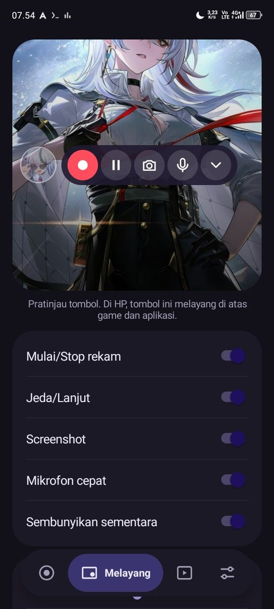
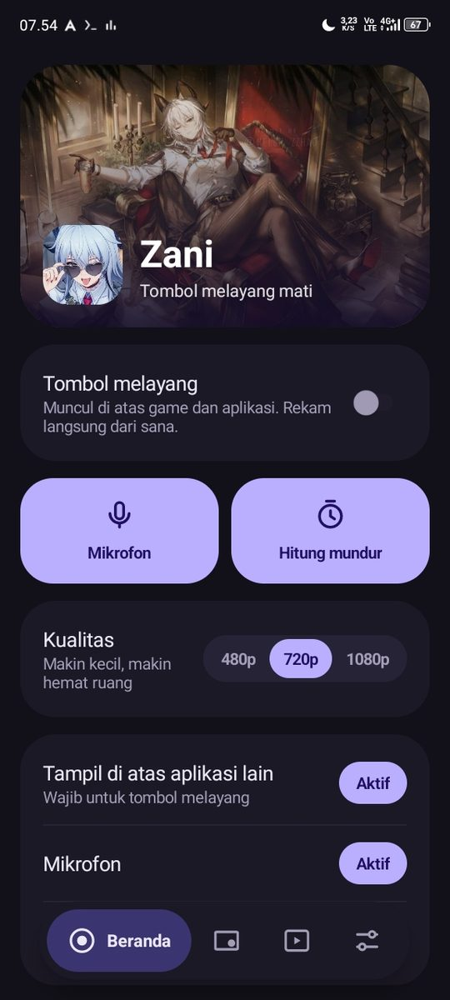
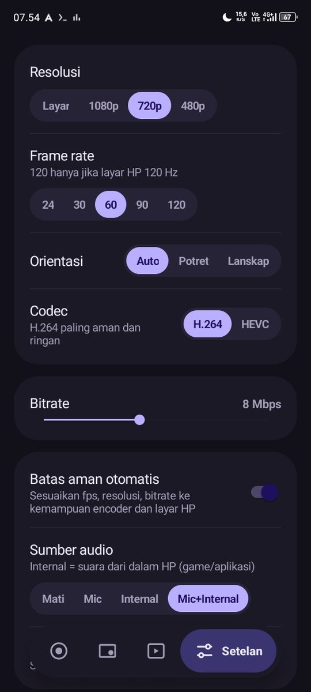

Perekam layar untuk Android. Tombolnya melayang di atas game.

**[Unduh APK](../../releases/latest)**

Android 8+ · 214 KB · tanpa iklan · tanpa internet

## Fitur

| | |
|---|---|
| **Rekam** | Mulai dan hentikan rekaman dari tombol melayang, tanpa keluar dari game. |
| **Jeda** | Tahan rekaman sebentar, lanjut lagi di file yang sama. |
| **Screenshot** | Ambil gambar layar kapan saja dari tombol yang sama. |

## Instalasi

1. Unduh APK terbaru di halaman [Releases](../../releases).
2. Buka file APK dan izinkan instalasi dari sumber ini.
3. Buka Zani, tombol melayang siap dipakai.
