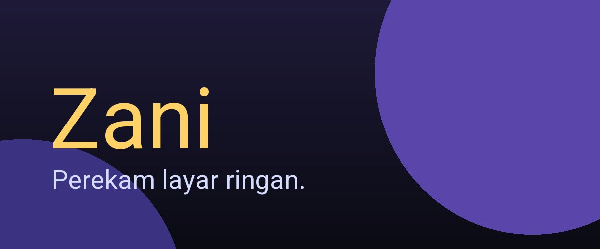
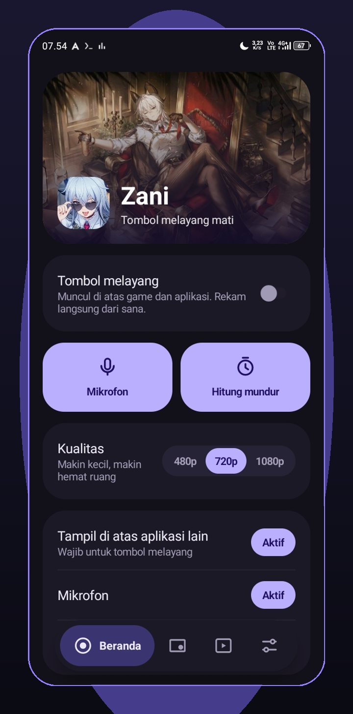
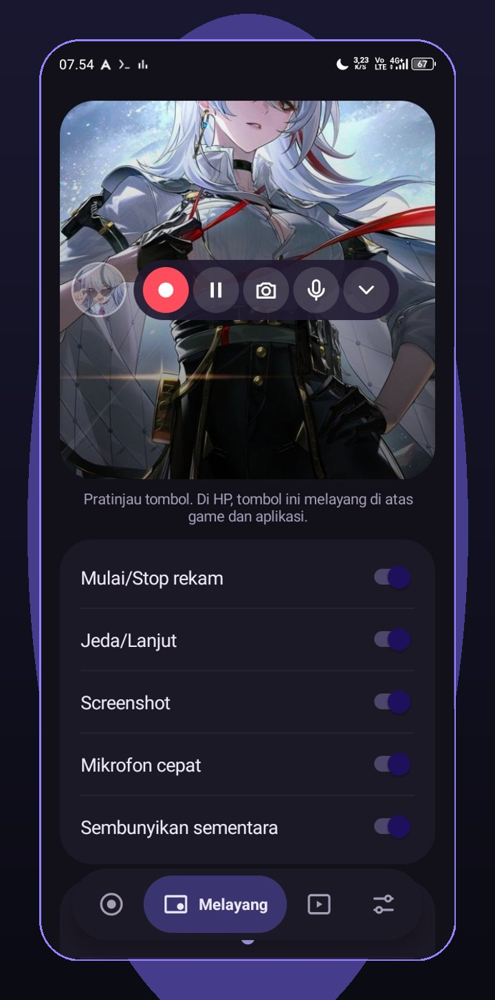
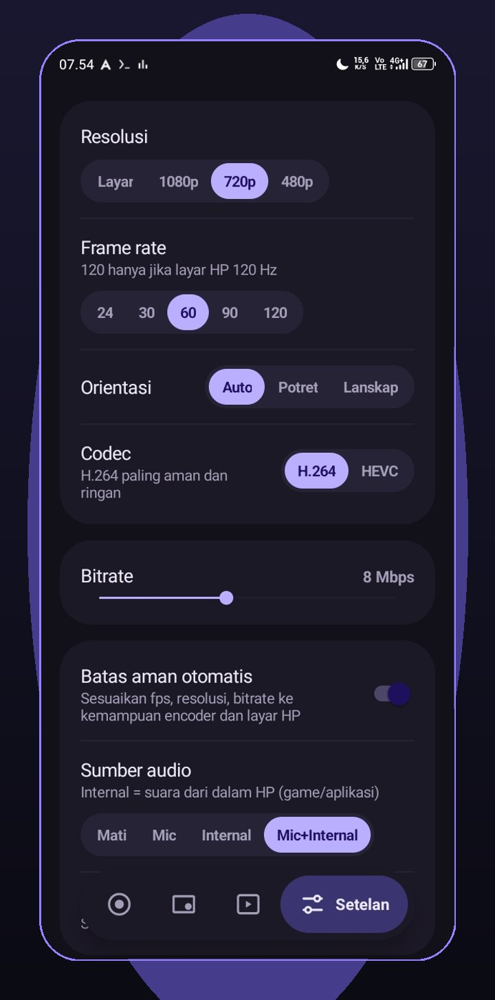

# Zani

Perekam layar buat Android. Tombolnya melayang di atas game: rekam, jeda, screenshot.

  

- Kecil (214 KB), tanpa iklan, tanpa internet
- Android 8 ke atas
- Unduh di halaman Release

---

Buat developer: Java + framework Android saja, tanpa library. Build lewat GitHub Actions otomatis (tes + APK). Detail: `BUILD_PROMPT.md`.
